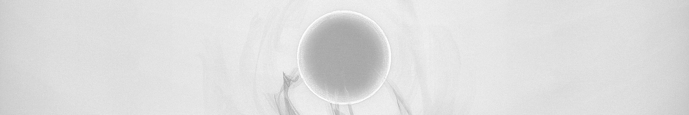

<picture>
  <source srcset="./assets/banner-dark.jpg" media="(prefers-color-scheme: dark)">
  
</picture>

## Setup

- **sway** - Tiling window manager
- **waybar** - Status bar
- **rofi** - Application launcher
- **foot** - Primary terminal emulator
- **foot-terminfo** - Terminfo entries for foot
- **kanata-bin** - Advanced keyboard remapper `Manual`

## Shell

- **zsh** - Unix shell
- **zsh-autosuggestions** - Zsh plugin
- **tmux** - Terminal multiplexer
- **fzf** - CLI fuzzy finder
- **fd** - Faster find alternative
- **ripgrep** - Recursive search tool
- **zoxide** - Smarter directory navigation
- **tree** - Directory tree viewer
- **chafa** - CLI image previewer

## Runtime

- **nodejs** - JavaScript runtime
- **pnpm** - Primary package manager

## Code

- **neovim** - Text editor
- **lazygit** - Git management TUI
- **git-delta** - Diff pager

## Display

- **swaylock** - Screen locker
- **swayidle** - Idle management daemon
- **gammastep** - Night color temperature
- **safeeyes** - Periodic eye-break reminders `AUR`

## System

- **impala** - Wi-Fi management TUI
- **bluetui** - Bluetooth management TUI
- **mako** - Notification daemon
- **cliphist** - Clipboard history
- **wl-clipboard** - Clipboard utilities
- **trash-cli** - CLI trash utility
- **7zip** - File compression and extraction
- **pacman-contrib** - Additional pacman utilities
- **rsync** - File synchronization tool
- **rclone** - Cloud synchronization tool
- **tlp** - Power management daemon
- **dex** - Desktop entry execution for autostart
- **xdg-desktop-portal** - App integration bridge
- **xdg-desktop-portal-wlr** - Screen capture and sharing
- **xdg-desktop-portal-gtk** - File picker and save dialogs

## Drives

- **gvfs-mtp** - MTP support for GVFS
- **exfatprogs** - exFAT filesystem utilities
- **dosfstools** - FAT filesystem utilities

## Apps

- **helium-browser-bin** - Primary web browser `AUR`
- **libreoffice** - Office suite
- **nemo** - File manager
- **nemo-fileroller** - Nemo archive integration
- **ffmpegthumbnailer** - Video thumbnail generator
- **mpv** - Media player
- **quodlibet** - Music player and library manager
- **imv** - Image viewer
- **flameshot** - Screenshot capture utility
- **gimp** - Image editor
- **hyprpicker** - Color picker
- **obs-studio** - Screen recording and streaming
- **seanime-denshi** - Anime library and streaming server `AUR`
- **stremio-enhanced-bin** - Media streaming client `AUR`

## Fonts

- **noto-fonts** - Google fonts
- **noto-fonts-cjk** - CJK character support
- **noto-fonts-emoji** - Emoji support
- **noto-fonts-extra** - Additional variants
- **inter-font** - Typeface for interfaces
- **ttf-jetbrains-mono-nerd** - Developer typeface

## Theme

- **swaybg** - Background utility
- **gnome-themes-extra** - Extra themes
- **papirus-icon-theme** - Icon theme
